# TechCare – Computer Service Center Management System

[](https://www.oracle.com/java/)
[](https://spring.io/projects/spring-boot)
[](https://supabase.com/)
[](https://react.dev/)
[](https://www.typescriptlang.org/)
[](https://vitejs.dev/)

**TechCare** is an end-to-end, full-stack management web application engineered for computer, laptop, and electronics service centers. Built specifically for an internship technical assessment, it demonstrates enterprise software design principles: clean layered architecture, relational database modeling, immutable audit trails, state machine workflows, and role-based access control (RBAC).

---

## 📑 Table of Contents
1. [Project Overview & Key Capabilities](#-project-overview--key-capabilities)
2. [Architecture & Technology Stack](#-architecture--technology-stack)
3. [User Roles & Demo Credentials](#-user-roles--demo-credentials)
4. [System Modules](#-system-modules)
5. [Database Architecture & Schema](#-database-architecture--schema)
6. [Quick Start Guide](#-quick-start-guide)
7. [API Testing with Postman](#-api-testing-with-postman)
8. [Future Mobile Integration (Android)](#-future-mobile-integration-android)
9. [Key Concepts for Technical Interviews](#-key-concepts-for-technical-interviews)

---

## 🚀 Project Overview & Key Capabilities

- **Strict Separation of Custody Assets vs. Shop Inventory:** Clearly distinguishes customer equipment brought in for repair (with serial numbers, physical check logs, passwords) from shop retail stock.
- **7-Stage Repair State Machine:** Enforces valid lifecycle transitions (`RECEIVED` → `DIAGNOSING` → `ESTIMATION_PENDING` → `APPROVED` → `IN_PROGRESS` → `READY_FOR_DELIVERY` → `DELIVERED`).
- **Immutable Status Audit History:** Every state change logs timestamp, previous status, new status, remarks, and the user who authorized it.
- **Double-Entry Stock Ledger:** Every spare part consumption, wholesale purchase, or manual count adjustment writes an immutable record into `stock_movements`.
- **Decoupled Invoicing & Multi-Tender Payments:** Supports advance deposits, partial payments, multiple payment methods (UPI, Cash, Card, Net Banking), and automated outstanding balance calculations.

---

## 🛠️ Architecture & Technology Stack

```
TechCare/
├── backend/                  # Java 17 + Spring Boot 3.2.5 REST API
│   ├── src/main/java/com/techcare/
│   │   ├── config/           # CORS & Application configuration
│   │   ├── controller/       # REST API endpoints (@RestController)
│   │   ├── dto/              # Request / Response DTOs
│   │   ├── entity/           # JPA Entities (Hibernate ORM)
│   │   ├── exception/        # Global Exception Handler (@ControllerAdvice)
│   │   ├── repository/       # Spring Data JPA repositories
│   │   ├── security/         # Spring Security 6 + JJWT stateless authentication
│   │   └── service/          # @Transactional business logic
│   ├── TechCare_Postman_Collection.json # Ready-to-import Postman collection
│   └── pom.xml
└── frontend/                 # React 18 + TypeScript + Vite Dashboard
    ├── src/
    │   ├── api/              # Axios client with JWT auto-injection interceptor
    │   ├── components/       # Responsive Sidebar, Navbar, Badges, Modals
    │   ├── context/          # AuthContext (stateless session & role management)
    │   ├── pages/            # Dashboard, Tickets, Customers, Inventory, Purchases, Billing
    │   └── types/            # TypeScript interfaces matching backend models
    ├── package.json
    └── vite.config.ts
```

| Layer | Technology |
| :--- | :--- |
| **Backend** | Java 17, Spring Boot 3.2.5, Spring Security 6, Spring Data JPA, Hibernate |
| **Database** | PostgreSQL 15+ hosted on Supabase Cloud |
| **Authentication** | Stateless JSON Web Tokens (JJWT 0.12.5) with BCrypt password hashing |
| **Frontend** | React 18, TypeScript 5.4, Vite 5.2, Lucide Icons |
| **API Testing** | Postman Collection with automated JWT extraction |

---

## 👥 User Roles & Demo Credentials

All demo accounts share the default password: **`password123`**  
*(The login screen also provides 1-click Quick Demo Fill buttons).*

| Role | Username | Permissions |
| :--- | :--- | :--- |
| **`ADMIN`** | `admin` | Full system access: financials, analytics, staff, vendor purchases, inventory creation. |
| **`RECEPTIONIST`** | `receptionist` | Counter desk operations: customer intake, job tickets, quotes, invoicing, and payments. |
| **`TECHNICIAN`** | `tech_arun` | Workbench engineering: diagnosis notes, status updates, consuming spare parts from inventory. |

---

## 📦 System Modules

1. **Dashboard & Analytics:** Real-time KPI counter cards (Active repairs, pending quotes, ready for delivery, low stock alerts) and financial summaries (Today's revenue, outstanding receivables).
2. **Customer & Device Intake:** Fast search by phone number or name, device profiling (Type, Brand, Model, Serial, physical condition inspection, accessories left).
3. **Repair Job Tickets:** Full ticket lifecycle management with priority levels, technician assignments, diagnostic logs, and part consumption.
4. **Spare Parts & Inventory:** Catalog with SKU, barcode, unit cost, and selling price. Color-coded stock level indicators and low-stock warning filters.
5. **Vendor Procurement:** Recording wholesale purchases from suppliers with automatic stock level increments.
6. **Billing & Invoicing:** Tax invoice generation pulling parts and labor charges directly from tickets, split payments, and printable formatted receipts.

---

## 🗄️ Database Architecture & Schema

The system uses 16 normalized relational tables complying with **Third Normal Form (3NF)**:

```mermaid
erDiagram
    USERS ||--o{ REPAIR_TICKETS : "assigned_to"
    CUSTOMERS ||--o{ CUSTOMER_DEVICES : "owns"
    CUSTOMER_DEVICES ||--o{ REPAIR_TICKETS : "serviced_in"
    REPAIR_TICKETS ||--o{ REPAIR_TICKET_LOGS : "has_history"
    REPAIR_TICKETS ||--o{ TICKET_PARTS_USED : "consumes"
    REPAIR_TICKETS ||--o| INVOICES : "generates"
    INVENTORY_ITEMS ||--o{ TICKET_PARTS_USED : "used_as"
    INVENTORY_ITEMS ||--o{ STOCK_MOVEMENTS : "tracks_flow"
    VENDORS ||--o{ PURCHASES : "supplies"
    PURCHASES ||--|{ PURCHASE_ITEMS : "contains"
    INVOICES ||--|{ INVOICE_ITEMS : "contains"
    INVOICES ||--o{ PAYMENTS : "settled_by"
```



- **`schema.sql`**: Complete PostgreSQL DDL with foreign key integrity, check constraints, and performance B-Tree indexes.
- **`seed_data.sql`**: Realistic sample dataset spanning customers, devices, stock items, purchases, repair tickets, invoices, and payments.

---

## ⚡ Quick Start Guide

### Prerequisites
- Java 17+ (JDK)
- Node.js 18+ & npm
- A free [Supabase](https://supabase.com) account (or local PostgreSQL 15+)

### 1. Database Setup
1. Create a project in Supabase.
2. In the Supabase **SQL Editor**, run the contents of [`schema.sql`](file:///C:/Users/DELL/.gemini/antigravity/brain/2bc389d2-e0d2-479b-9b34-3a8e0b18deff/schema.sql).
3. Next, run the contents of [`seed_data.sql`](file:///C:/Users/DELL/.gemini/antigravity/brain/2bc389d2-e0d2-479b-9b34-3a8e0b18deff/seed_data.sql).

### 2. Run the Backend (Spring Boot)
1. Open `backend/src/main/resources/application.properties` and add your Supabase credentials:
   ```properties
   spring.datasource.url=jdbc:postgresql://db.<your-project-ref>.supabase.co:5432/postgres?sslmode=require
   spring.datasource.username=postgres
   spring.datasource.password=<YOUR_SUPABASE_PASSWORD>
   ```
2. Start the Spring Boot server:
   ```powershell
   cd c:\PROJECTS\TechCare\backend
   mvn spring-boot:run
   ```
   *The backend will boot up at `http://localhost:8080`.*

### 3. Run the Frontend (React + Vite)
```powershell
cd c:\PROJECTS\TechCare\frontend
npm run dev
```
*Open `http://localhost:5173` in your browser and sign in with the 1-click demo buttons.*

---

## 🧪 API Testing with Postman

A pre-configured Postman collection is included in [`backend/TechCare_Postman_Collection.json`](file:///c:/PROJECTS/TechCare/backend/TechCare_Postman_Collection.json).
1. Open Postman and click **Import**.
2. Select `TechCare_Postman_Collection.json`.
3. Execute the **"Login (Admin)"** request.
   - *A test script automatically saves the JWT token into the collection variable `{{token}}`.*
4. All subsequent requests (Dashboard stats, creating intake tickets, consuming parts, billing) will automatically use this token.

---

## 📱 Future Mobile Integration (Android)

TechCare was deliberately architected with an **API-First, Headless REST Design**:
- Zero server-rendered HTML; 100% platform-agnostic JSON payloads.
- Stateless JWT authentication enabling secure mobile storage using Android's `EncryptedSharedPreferences`.
- Prepared for native Android features: **Google ML Kit** for instant camera barcode scanning of spare parts and equipment serials.
- Detailed architecture and Kotlin Retrofit code samples are documented in [`ANDROID_INTEGRATION_PLAN.md`](file:///C:/Users/DELL/.gemini/antigravity/brain/2bc389d2-e0d2-479b-9b34-3a8e0b18deff/ANDROID_INTEGRATION_PLAN.md).

---

## 💡 Key Concepts for Technical Interviews

When presenting TechCare to evaluators, highlight these 4 architectural decisions:

1. **Why separate `customer_devices` from `inventory_items`?**  
   *Customer devices are liabilities under temporary custody with legal warranties, physical inspection logs, and passcodes. Inventory items are shop-owned retail assets purchased from suppliers.*
2. **Why use an immutable `stock_movements` ledger?**  
   *Prevents ghost inventory and unexplained stock count discrepancies. Every addition or deduction has an auditable cause (`PURCHASE`, `REPAIR_CONSUMPTION`, `RETAIL_SALE`).*
3. **How does the ticket state machine prevent disputes?**  
   *`repair_ticket_logs` creates an unalterable paper trail of who changed the status, at what exact timestamp, and with what customer communication remarks.*
4. **Why decouple `payments` from `invoices` in a 1-to-many relationship?**  
   *Enables real-world split payments, advance deposits at check-in, and partial payments with outstanding receivable tracking.*

